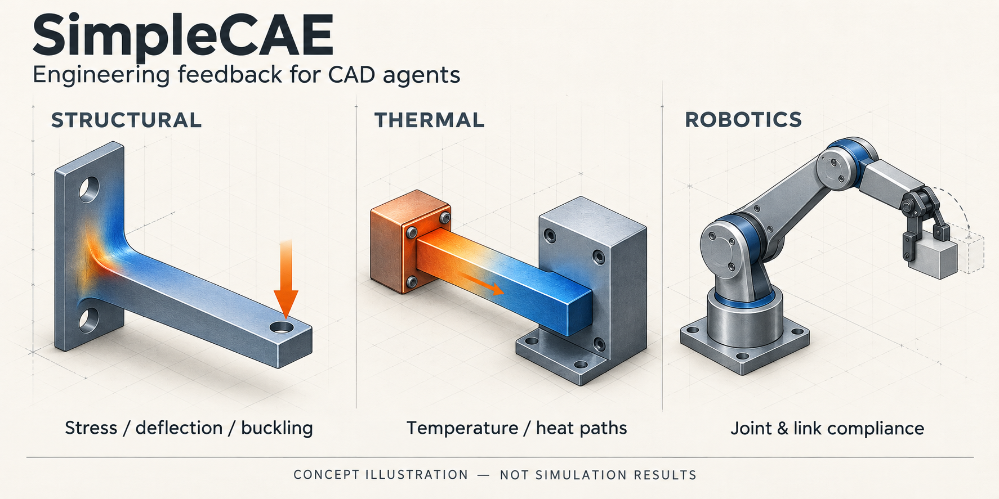
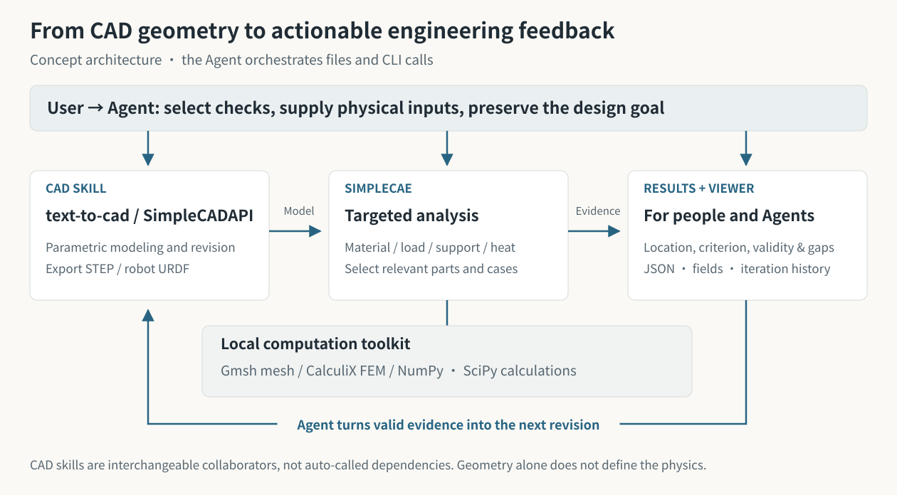
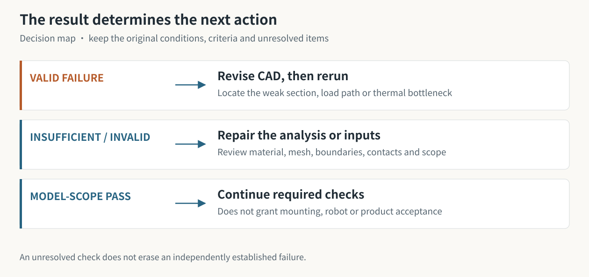

# SimpleCAE

**Local structural, thermal and robotics checks for CAD Agents — with feedback for the next design revision.**

[简体中文](README.md) · [Capabilities](#what-can-it-analyze) · [CAD integration](#how-it-works-with-cad-skills) · [Real example](#a-real-cad--cae-iteration) · [Install](#install-the-runtime)



*Concept illustration, not simulation results. Reproducible example evidence appears below.*

SimpleCAE combines an **Agent skill, a Python toolkit and a local results Viewer**.
Describe the use of your object. The Agent selects relevant parts and conditions,
runs checks, and brings **where, why and what to change next** back to CAD.
Geometry, material, mounting and load conditions together define the analysis.

**Static strength & stiffness · Thermal analysis · Contact & bolt preload · Robot compliance & motion loads · Modal screening · Data-backed fatigue & creep**

It runs locally with Gmsh, CalculiX and numerical tools. No commercial CAE application
or cloud solver account is required. The calling Agent uses its own host/model and terminal access.

## What can it analyze?

| Capability | Design question | Feedback for the CAD / robotics Agent |
|---|---|---|
| **Structural loading** | Too flexible? High stress? A linear buckling concern? | Stress, displacement, utilization, task probes and hotspot locations; compare thickness, fillets, ribs or load-path changes |
| **Thermal analysis** | Where is it hot? Can heat escape? How does temperature rise? | Steady / transient networks, solid temperature fields and heat-flow evidence; compare conducting sections, paths, materials or stated cooling boundaries |
| **Mounting & connections** | How do preload, separation and planar friction affect the mounted part? | Equivalent axial bolt tightening → locking → service; retain every stage and interface issue to guide mounting-model or connection changes |
| **Robotics & mechanisms** | Do joints or links dominate tip error? What effort does a named motion state require? | URDF statics, selected link FEM, equivalent joint compliance and motion-state loads; identify whether to review structure, joints or drive configuration |
| **Modal screening** | Are natural frequencies near a stated excitation band? | Frequencies, mode shapes and band separation to inform stiffness, mass distribution or mounting changes |
| **Fatigue / creep screening** | With applicable material data, is repeated or sustained loading acceptable? | Curve-based damage, life or creep response tied to stress / temperature evidence; missing data remains a gap |

**Inputs:** STEP is the main solid-analysis format. Selected structural paths also
accept suitable closed GLB / STL / OBJ meshes. URDF describes a robot; selected-link
analysis needs its geometry and materials. The Agent supplies units, material,
load / thermal boundaries, mounting and acceptance criteria. [Format scope](references/model-adapters.md)

**Outputs:** structured `result.json` / `signal.json`, readable reports, supported
field data and Viewer iteration records. These distinguish a valid design failure
from an analysis that needs repair or lacks sufficient evidence.

<details>
<summary>Scope and limits of these capabilities</summary>

- Structural paths cover supported linear elasticity, strength / stiffness and linear eigenvalue buckling; not nonlinear ultimate-load or fracture prediction.
- Mounting covers supported planar contact / friction and equivalent axial bolts; not arbitrary curved contact, large sliding, real threads, bolt bending/shear or anchor pullout.
- Thermal methods cover networks and solid heat transfer; not CFD or automatic thermal-stress coupling. Local heat-flux accuracy requires separate evidence.
- Robot compliance covers supported fixed-base trees / held states and first-order transfer. Motion loads are named-state calculations, not controller, full-trajectory or flexible multibody simulation.
- Modal amplitudes are arbitrary, not forced-vibration predictions. Fatigue / creep needs applicable material curves; it cannot invent an FDM life rating.
- CAD / DfAM tools can supply fit and manufacturing checks as revision-bound records. Recording them is not independent verification by SimpleCAE.

[Full methods and input contracts](SKILL.md) · [Choosing checks by use](references/use-driven-checks.md)

</details>

## Who uses it?

| User / task | Useful first checks | A possible next step |
|---|---|---|
| Maker designing a hook, desk stand or gripper | Fit, load path, relevant strength and deflection | Revise a weak section or fillet; resolve unknown mounting / print data first |
| Robotics developer building an arm or sensor mount | Joint/link compliance, mounting interfaces and named motion states | Separate joint problems from structural problems before thickening links |
| Mechanical / mechatronics student comparing designs | Stiffness, temperature or modes under the same conditions and criteria | Explain the design difference with evidence and a valid before/after comparison |
| CAD Agent or custom Agent system | A small set of checks that can change a decision | Read structured feedback, call a CAD skill and create the next revision |

A hand-driven planetary gear toy may need fit, backlash and motion checks first.
A specific force, payload or temperature target can then justify selected CAE.
**An assembly is not a requirement to solve every part.**

## How it works with CAD skills



| Role | Owns | Hands off |
|---|---|---|
| **Agent** | Use, check selection, physical assumptions and evidence-based revision decisions | Task, conditions, criteria and next action |
| **text-to-cad / SimpleCADAPI** | Parametric modeling, editing, assembly and export; editable design sources | STEP / supported meshes / URDF and geometry revisions |
| **SimpleCAE** | Input checks, selected computation, validity checks, problem localization and feedback | JSON signals, fields, reports and task-linked Viewer records |

The toolkit uses **Gmsh meshing, CalculiX FEM and NumPy / SciPy calculations** as
appropriate. `SKILL.md` guides the Agent; CLI / Python / JSON provide callable
interfaces; Viewer exposes evidence and iteration history to people.

With [text-to-cad](https://github.com/earthtojake/text-to-cad), use parametric CAD
generation/editing, export and relevant DfAM / manufacturing checks. With
[SimpleCADAPI](https://github.com/PhySpace/SimpleCADAPI), use editable modeling
sources, parameters and assembly constraints to keep changes traceable.
**The Agent orchestrates the skills through files and structured results.
SimpleCAE does not automatically call or install either CAD tool.**

Example requests for an Agent with both skills available:

> Use text-to-cad to design a fixed-angle PLA desk stand for a 250 g phone,
> supporting portrait and landscape use with charging-cable clearance. Check fit,
> stability and print orientation first, then use SimpleCAE for relevant loading
> and deflection. Revise the controlling issue and compare both versions in Viewer.

> Use SimpleCADAPI to model and revise a controller heat bridge: 5 W heat input,
> ideal 20°C cold end and a 40°C temperature limit. Use SimpleCAE to identify the
> heat path and compare bridge sections under unchanged boundaries. Keep unknown
> real contact resistance separate.

> For my existing URDF arm, use SimpleCAE to distinguish joint and link contributions
> to tip error. Ask for missing material or joint stiffness; do not infer stiffness
> from URDF effort limits. Call the CAD skill to revise a link only when justified.

These are request examples, not default loads, material properties or qualified designs.

## How analysis leads to a better revision



Useful feedback connects **part/location → controlling criterion → use impact →
revision direction → remaining gaps**. A valid high root stress can justify
comparing fillets or ribs. Invalid contact or mesh evidence needs analysis repair
first. Joint-dominated robot error does not justify thickening every link.
The Agent implements permitted changes; SimpleCAE does not promise a revision will pass.

After a geometry change, create a new revision and rebind load/mounting faces.
Keep requirements and criteria consistent to explain whether the change helps.
This supports reliability through inspectable evidence; a scoped model pass is not product acceptance.

## A real CAD → CAE iteration

**A four-part controller mount, one selected heat bridge.** The image below is the
bundled CAD preview; the numbers are from its reproducible example, not the concept artwork.


| Unchanged: 5 W input, ideal 20°C cold end, 40°C limit | R1 | R2 |
|---|---|---|
| Only changed parameter: bridge thickness | 2 mm | 4 mm |
| Example maximum temperature | ≈49.94°C | ≈34.97°C |
| This temperature criterion | Fails | Passes under the stated model |

Resistance and solid-temperature evidence guide the section change. Real contact
resistance, cooling and hot structural performance remain separate checks.
[Inputs, editable CAD and reproduction steps](examples/showcase/thermal-bridge/README.md)

Two further cases illustrate useful outcomes beyond a pass:

- [Two-joint inspection arm](examples/showcase/inspection-arm/README.md): separate joint/link contributions; unresolved transfer applicability prevents a misleading thickness recommendation.
- [Bolted sensor mast](examples/showcase/sensor-mast/README.md): retain preload, locked and service stages; service success cannot hide an unresolved root hotspot.

## Install the runtime

This checkout includes first-use maintenance fixes on top of 1.6.0. See
[validation scope](validation/README.md); the archived release receipt belongs
to the earlier snapshot and is not an installation prerequisite.

For host skill discovery, first follow “Connect your Agent” below, then run setup
inside the installed folder. Create the runtime once. Agents using this source
folder directly do not need an additional installed copy.

Use a writable source folder and **64-bit Python 3.11+**; Python 3.11 is the
recommended common baseline. Initial dependency downloads need network access.
Run commands from this folder.

**Windows PowerShell**

```powershell
powershell -NoProfile -ExecutionPolicy Bypass -File scripts/bootstrap.ps1
.\.venv\Scripts\python.exe scripts/simplecae_cli.py --version
# Optional: one real solver example
.\.venv\Scripts\python.exe scripts/simplecae_cli.py quickstart --out outputs/first-001
```

No shell activation is required. Bootstrap reuses a compatible local runtime and
configured solver; otherwise it installs runtime dependencies within the declared
version bounds. Tests are not an installation prerequisite. `-Locked` is an optional
Windows maintainer setup for the full test dependency lock. A newly downloaded
CalculiX archive is checked before extraction. Supply `-Python PATH` or `-Ccx PATH`
to select a full Python (including venv/ensurepip) or solver; stripped Agent Python
runtimes may not support environment creation.

**Ubuntu / bash**

Install prerequisites with your normal package-management permissions:

```bash
sudo apt-get update
sudo apt-get install python3-venv calculix-ccx libglu1-mesa libxft2 libxcursor1 libxinerama1 libgomp1
bash scripts/bootstrap.sh
.venv-linux/bin/python scripts/simplecae_cli.py --version
# Optional: one real solver example
.venv-linux/bin/python scripts/simplecae_cli.py quickstart --out outputs/first-001
```

The selected Python must be >=3.11; use `--python /path/to/python3.11` if needed.
Use `--ccx /path/to/ccx` for an existing solver. Bootstrap does not run `sudo`
or modify system packages. Linux uses separate `.venv-linux` and preserves
Windows solver settings in shared folders. Ubuntu dependencies resolve within
declared version bounds; record `doctor` output for reproduction.

An existing healthy environment can go straight to the user task. `quickstart
--example all`, pytest, dependency audits and release verification are optional
learning/maintainer workflows, not mandatory first-use steps. Reuse an existing
quickstart result rather than rerunning it; use a fresh output directory when a
new solve is actually needed. Opening Viewer alone starts no solve.

Installed environments can also call `python -m simplecae`. A wheel contains
runtime assets/examples; the **source folder** is the installable Agent skill.
[Dependency details](references/dependencies.md).

## Connect your Agent

Start with **“Read this folder's SKILL.md and use SimpleCAE.”** For discovery,
install the source folder (destination preview is optional):

```text
python scripts/install_local.py --agent codex --show-target
python scripts/install_local.py --agent codex
```

Ordinary installation needs no release receipt or source SHA-256 comparison.
Missing/stale receipts do not block it. `--verify-release` is an optional maintainer
audit, not a first-use step. `--development` also works without a receipt.
Solver download integrity and analysis validity checks remain enabled.

| Host | Flag | Default discovery root |
|---|---|---|
| Codex | `codex` | `$CODEX_HOME/skills` or `~/.codex/skills` |
| Claude Code | `claude` | `$CLAUDE_CONFIG_DIR/skills` or `~/.claude/skills` |
| DeepSeek Harness | `deepseek` | `~/.agents/skills` |
| OMP / oh-my-pi | `omp` | `~/.omp/agent/skills` |
| Pi | `pi` | `~/.agents/skills` |

Use `--skills-root PATH` for project roots/custom profiles. Managed sources receive
a backup; environments, tools, outputs and unrelated root files are preserved.
Run bootstrap in a new installation folder, then reload host discovery.
Source copying alone does not install the Python runtime.
[Official host references and details](references/agent-installation.md).
Discovery compatibility is distinct from live testing of every host/model.

## Run the example iteration

```text
simplecae task start examples/showcase/thermal-bridge/r1/task.json --out outputs/bridge-r1 --run temperature --brief
simplecae task start examples/showcase/thermal-bridge/r2/task.json --out outputs/bridge-r2 --viewer-session outputs/bridge-r1/viewer --run temperature --brief
simplecae task status outputs/bridge-r2 --brief
simplecae view --session outputs/bridge-r1/viewer --serve --open
```

Without `--run`, start only prepares. Use `task run --check NAME` for another
computation and `task record` for external evidence. An unchanged retry needs a
concrete `--retry-reason`; a passed check does not need another solve.
[Task API](references/agent-tasks.md) · [Python/JSON API](references/agent-api.md).


## Results, Viewer and disk use

| Result | Meaning / next action |
|---|---|
| `pass_under_stated_model` | Assessed criteria pass within scope; continue other required checks |
| `fail_under_stated_model` | Valid evidence establishes failure; propose a targeted permitted change |
| `indeterminate` | Evidence/coverage/convergence insufficient; resolve before favorable ranking or capacity |
| `invalid` | Input/environment/mesh/solver checks failed; repair analysis first |

`result.json`, `signal.json`, `report.html` and task/design summaries retain the
evidence. Independent confirmed failures remain actionable when another criterion
is unresolved. No numerical state automatically grants whole-product acceptance.

The Viewer shows real fields, iterations, stage records and annotations on
`127.0.0.1`, without automatic upload or external web assets. Annotations are
review input, not executable CAD commands. [Display scope](references/viewer.md).

Default `compact` storage losslessly compresses native DAT/FRD/MSH after readers
finish. It keeps all mesh levels, full fields, decks, logs and failures. It does
not silently delete old projects or create a second cache.
[Retention](references/storage.md).

For expensive work, inspect `doctor` and execution records, select a justified
budget and calibrate a representative static/contact deck once. Auto mode uses
an applicable measured CPU profile or serial fallback; it does not predict
sparse-matrix memory fit or weaken accuracy to meet a deadline.
[Parallel execution](references/execution-resources.md).

## Feedback, verification and license

Use the [feedback template](assets/feedback-template.md) with a minimal shareable
case, version/platform, expected decision and logs. Check private geometry/paths
before sharing. No feedback is uploaded automatically.

[Contributing](CONTRIBUTING.md) · [Verification](references/release-requirements.md) ·
[Current evidence scope](references/platform-evidence.md)

Source, documentation and authored examples are **GPL-3.0-or-later**.
See [LICENSE](LICENSE), [NOTICE](NOTICE.md) and the
[dependency inventory](licenses/dependency-inventory.json). Source archives exclude
environments, solver binaries, user results and private audit history.
Redistributing dependencies separately carries their own license obligations.
