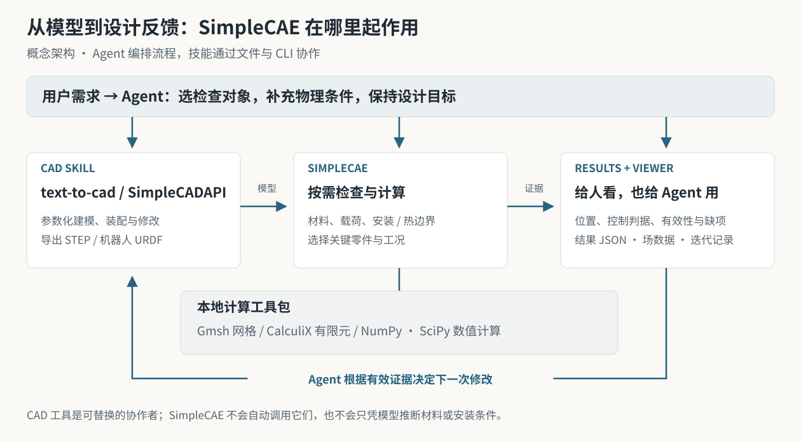
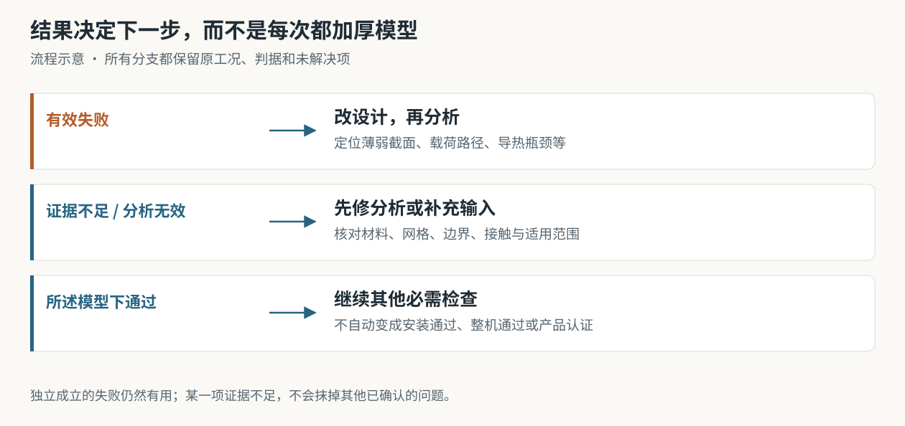

# SimpleCAE

**让 CAD 与机器人 Agent 在本地检查受力、温度和结构响应，再据此改进模型。**

[English](README.en.md) · [能分析什么](#能分析什么) · [如何协作](#如何与-cad-skill-协作) · [真实案例](#一个真实的-cad--cae-迭代) · [安装](#安装运行环境)


*能力概念插画，非求解结果。实际分析输出见下方可复现案例。*

SimpleCAE 是一套 **Agent skill + Python 工具包 + 本地结果 Viewer**。
你说明用途，Agent 选择值得检查的零件和工况，调用计算，再把“哪里有问题、
为什么、下一步改什么”带回 CAD 设计。模型、材料、安装和载荷条件共同决定分析。

**静力强度与刚度 · 热分析 · 安装接触与预紧 · 机器人柔度与运动载荷 · 模态 · 材料数据驱动的疲劳与蠕变**

支持本地 Gmsh / CalculiX 和数值计算，无需商业 CAE 软件或云求解账号。
调用它的 Agent 仍使用自己的宿主、模型和终端权限。

## 能分析什么

| 能力 | 能回答什么 | 能给 CAD / 机器人 Agent 什么反馈 |
|---|---|---|
| **结构受力** | 支架会不会太软？哪里应力高？线性屈曲是否值得担心？ | 应力、位移、强度利用率、测点响应和热点位置；帮助判断是否调整厚度、圆角、加强筋或载荷路径 |
| **热分析** | 热量能否传出去？哪里温度高？升温过程是否满足要求？ | 稳态 / 瞬态热网络、实体导热温度场及热流证据；支持比较导热截面、路径、材料或明确的冷却边界 |
| **安装与连接** | 零件装上之后怎样受力？预紧、接触分离、平面摩擦会怎样影响结果？ | 等效轴向螺栓的预紧 → 锁定 → 工作加载；保留各阶段和接口问题，帮助检查安装建模或连接布置 |
| **机器人与机构** | 末端偏移来自连杆还是关节？指定加速 / 制动状态需要多少驱动力？ | URDF 静力、选中连杆 FEM、等效关节柔度、指定运动状态载荷；支持先判断该改结构、关节参数还是驱动配置 |
| **模态筛查** | 固有频率是否接近给定的激振频段？ | 频率、振型和声明频段的间隔，辅助调整刚度、质量分布或安装条件 |
| **疲劳 / 蠕变筛查** | 在有适用材料数据时，反复载荷或长期承载是否满足条件？ | 由材料曲线和应力 / 温度证据计算的损伤、寿命或蠕变响应；数据不足就保留缺项 |

**输入**：STEP 是实体分析的主要入口；部分结构检查支持适用的闭合 GLB / STL / OBJ 网格；
URDF 描述机器人结构，具体连杆分析另需几何和材料。另由 Agent 填入单位、材料、
载荷 / 热边界、安装条件和验收判据。[格式与限制](references/model-adapters.md)

**输出**：结构化 `result.json` / `signal.json`、可读报告、支持的场数据和 Viewer 迭代记录。
Agent 能据此区分设计确实不满足要求、分析本身需要修复，以及证据还不够。

<details>
<summary>展开查看适用边界：这些能力具体覆盖到哪里？</summary>

- 结构以支持范围内的线弹性、强度 / 刚度与线性特征值屈曲为主；不等于非线性极限承载或破坏预测。
- 安装支持声明范围内的平面接触 / 摩擦及等效轴向螺栓；不覆盖任意曲面、大滑移、真实螺纹、螺杆弯剪或锚固拉拔。
- 热分析覆盖热网络与实体传热；不是 CFD，不自动耦合热应力，局部热流精度需独立证据。
- 机器人柔度限于支持的固定基座树形 / 保持状态及一阶传递；运动载荷是指定状态计算，不是完整控制器、轨迹或柔性多体仿真。
- 模态振型幅值任意，不预测强迫振动幅值；疲劳 / 蠕变必须有适用的材料曲线，不能凭空给 FDM 打印件寿命。
- 装配间隙、制造可行性等可以由 CAD / DfAM 工具检查后登记；记录不等于 SimpleCAE 独立验证。

[完整方法与输入合同](SKILL.md) · [如何按用途选择检查](references/use-driven-checks.md)

</details>

## 谁会用，怎么用

| 使用者 / 场景 | 先检查什么 | 下一步可能怎么做 |
|---|---|---|
| 创客做挂钩、桌面支架、夹爪 | 尺寸 / 装配、载荷路径、必要的强度和变形 | 改薄弱截面或圆角；安装和打印材料不明确时先补输入 |
| 机器人开发者做机械臂、传感器支座 | 关节与连杆柔度、安装接口、指定运动状态 | 区分关节问题与结构问题，避免只加厚连杆 |
| 机械 / 机电学生比较设计方案 | 在相同工况和判据下比较刚度、温度或模态 | 用计算结果解释设计差异，并展示有效的前后对比 |
| CAD Agent 或自建 Agent 系统 | 从需求选择少量能改变决策的检查 | 读取结构化反馈，调用 CAD skill 修改，再建立新修订 |

例如手动行星齿轮玩具，先查装配、齿隙与运动关系通常更有价值；明确夹紧力、
承重或温度目标后，再选择相应 CAE。**不默认对整个装配的所有零件逐个求解。**

## 如何与 CAD skill 协作



| 角色 | 负责什么 | 交给下一步什么 |
|---|---|---|
| **Agent** | 理解用途，选择检查，补充物理假设；根据有效证据决定是否改型 | 任务、工况、判据和迭代决策 |
| **text-to-cad / SimpleCADAPI** | 参数化建模、编辑、装配与导出；保留可修改的设计源文件 | STEP / 适用网格 / URDF 和模型修订 |
| **SimpleCAE** | 检查输入，运行选定的计算，核查有效性，定位问题并组织反馈 | JSON 信号、场数据、报告和同一任务的 Viewer 记录 |

底层按任务使用 **Gmsh 网格、CalculiX 有限元，以及 NumPy / SciPy 数值计算**。
`SKILL.md` 指导 Agent 做选择，CLI / Python / JSON 提供稳定调用入口，Viewer 让人查看证据与迭代。

与 [text-to-cad](https://github.com/earthtojake/text-to-cad) 搭配时，用它生成 / 修改参数化模型、
导出文件，并按需做 DfAM / 制造检查；与 [SimpleCADAPI](https://github.com/PhySpace/SimpleCADAPI)
搭配时，用可编辑建模源、参数与装配约束保持设计可追溯。
**联动由 Agent 编排，交换文件与结构化结果；SimpleCAE 不会自行调用或自动安装这些 CAD 工具。**

可以直接对同时具备两个 skill 的 Agent 说：

> 用 text-to-cad 做一个固定角度的桌面手机支架，手机 250 g，PLA 打印，
> 竖放 / 横放都能用并预留充电线。先检查尺寸、稳定性和打印方向，再用
> SimpleCAE 检查必要的受力与变形；根据控制问题修改模型，在 Viewer 对比两版。

> 用 SimpleCADAPI 建模并修改控制板导热支座。热源 5 W、理想冷端 20°C、
> 温度上限 40°C。用 SimpleCAE 先找关键导热路径，再比较桥的截面，
> 保持边界条件一致，并把实际接触热阻等未知项单独列出。

> 我已有一台 URDF 机械臂。用 SimpleCAE 判断末端偏移主要来自连杆还是关节；
> 材料和关节刚度不足时先问我，不要从 URDF 力矩限值猜刚度。
> 只有结构修改有依据时，再调用 CAD skill 改相应连杆。

这些是请求示例，不是默认载荷、材料参数或已通过的设计。

## 分析怎样帮助改型



有效反馈会说明**对象与位置 → 控制判据 → 使用影响 → 建议修改方向 → 还缺什么**。
例如，根部高应力且结果有效时，可以比较圆角或加强筋；若只是接触或网格无效，
应先修分析；若机械臂偏移主要受关节柔度控制，不能直接建议加厚所有连杆。
建议由 Agent 结合允许的改动实现，**SimpleCAE 不承诺某个改型必然通过**。

几何修改后建立新修订，重新绑定载荷和安装面；保持要求和判据一致，才能解释是否改善。
这让可靠性改进建立在可检查的证据上；单项模型通过不等于实物产品通过。

## 一个真实的 CAD → CAE 迭代

**四部件控制板支座，只分析关键导热桥。** 下面是随包 CAD 预览；数值来自随包可复现案例，非上方概念插画。


| 保持不变：5 W 热输入、理想 20°C 冷端、40°C 上限 | R1 | R2 |
|---|---|---|
| 唯一修改的导热桥厚度 | 2 mm | 4 mm |
| 该示例计算的最高温度 | 约 49.94°C | 约 34.97°C |
| 这一温度判据 | 不满足 | 满足所述模型下的要求 |

Agent 据热阻与实体温度证据修改导热截面；实际接触热阻、冷端散热和高温结构强度仍需另查。
[查看输入、可编辑 CAD 与复现步骤](examples/showcase/thermal-bridge/README.md)

另外两个完整案例展示不同的反馈，而不只展示通过：

- [两关节巡检臂](examples/showcase/inspection-arm/README.md)：分别看关节与连杆贡献；传递适用性不足时，阻止误导性的加厚建议。
- [螺栓传感器立柱](examples/showcase/sensor-mast/README.md)：保留预紧、锁定和工作阶段，工作阶段通过不能掩盖根部热点的不收敛。

## 安装运行环境

当前目录包含 1.6.0 的首次使用流程修复。[本次验证范围](validation/README.md)
单独说明；旧发布凭证已归档，不作为当前源码的验证声明或安装门槛。

若要安装到 Agent 的技能目录，先做下节的“安装到 Agent”，再进入安装目标运行
以下命令，只建立一次环境。直接让 Agent 使用当前源码目录则无需再复制一份。

源码放在可写目录，准备 **64位Python 3.11以上**，推荐共同基线Python 3.11。
首次下载依赖需要联网；以下命令在SimpleCAE目录执行。

**Windows PowerShell**

```powershell
powershell -NoProfile -ExecutionPolicy Bypass -File scripts/bootstrap.ps1
.\.venv\Scripts\python.exe scripts/simplecae_cli.py --version
# 可选：只运行一个真实求解示例
.\.venv\Scripts\python.exe scripts/simplecae_cli.py quickstart --out outputs/first-001
```

无需激活环境。脚本优先复用符合依赖范围的本地环境和已配置求解器；需要新装时
只安装运行依赖。`-Locked` 留给需要复现完整测试依赖的维护者。新下载的求解器
仍在解压前校验完整性。自选解释器／求解器加 `-Python PATH`、`-Ccx PATH`。
Python 必须包含 `venv` 和 `ensurepip`；Agent 自带的精简版可能没有，可直接指定
机器上已有的完整版 Python。已有正常环境不需要另找系统 Python。

**Ubuntu / bash**

使用正常系统包管理权限安装依赖：

```bash
sudo apt-get update
sudo apt-get install python3-venv calculix-ccx libglu1-mesa libxft2 libxcursor1 libxinerama1 libgomp1
bash scripts/bootstrap.sh
.venv-linux/bin/python scripts/simplecae_cli.py --version
# 可选：只运行一个真实求解示例
.venv-linux/bin/python scripts/simplecae_cli.py quickstart --out outputs/first-001
```

所选Python必须>=3.11，必要时加 `--python /path/to/python3.11`；
自备求解器加 `--ccx /path/to/ccx`。bootstrap本身不执行sudo或修改系统包。
Linux使用独立 `.venv-linux`，保留共享目录中的Windows求解器配置。
Ubuntu依赖按声明版本范围解析，复现时记录 `doctor` 输出。

已有正常环境可直接开始用户任务。`quickstart --example all`、完整 pytest、许可证
审计和发布验证都不是首次使用的必经步骤；全部示例仅供需要了解不同结果时选用。
已有 quickstart 结果可以直接查看，需要重新求解时再使用新目录，避免覆盖旧证据。
单独打开 Viewer 不会启动求解。

已有环境也可用 `python -m simplecae`。wheel含运行资源及示例；
安装到Agent的skill使用**源码文件夹**。[依赖说明](references/dependencies.md)。

## 安装到 Agent

可直接让Agent“读取这个目录的SKILL.md并使用SimpleCAE”。需要自动发现时，
直接安装源码文件夹即可；查看目标是可选步骤：

```text
python scripts/install_local.py --agent codex --show-target
python scripts/install_local.py --agent codex
```

普通安装不要求发布凭证，不反复计算源码、备份或安装副本的 SHA-256；凭证缺失或
过期都不会阻塞安装，也不需要重新生成凭证或对比 GitHub 文件。
`--verify-release` 只供维护者主动审计发布源码；`--development` 兼容普通安装，
同样不要求凭证。下载求解器的完整性检查和分析结果有效性检查仍保留。
DeepSeek Harness 项目级安装可用：

```powershell
python scripts/install_local.py --skills-root 'C:\你的工作区\.dsh\skills'
```

| 宿主 | `--agent` | 默认发现目录 |
|---|---|---|
| Codex | `codex` | `$CODEX_HOME/skills`，否则`~/.codex/skills` |
| Claude Code | `claude` | `$CLAUDE_CONFIG_DIR/skills`，否则`~/.claude/skills` |
| DeepSeek Harness | `deepseek` | `~/.agents/skills` |
| OMP / oh-my-pi | `omp` | `~/.omp/agent/skills` |
| Pi | `pi` | `~/.agents/skills` |

项目或自定义profile加 `--skills-root PATH`。安装器备份受管理源码，保留已有环境、
工具、结果和无关根目录文件。新安装目录运行bootstrap，再刷新宿主技能发现；
复制源码本身不等于安装Python环境。[详细说明及官方文档](references/agent-installation.md)。
目录兼容验证不代表已测试每个Agent／模型组合。

## 运行示例迭代

```text
simplecae task start examples/showcase/thermal-bridge/r1/task.json --out outputs/bridge-r1 --run temperature --brief
simplecae task start examples/showcase/thermal-bridge/r2/task.json --out outputs/bridge-r2 --viewer-session outputs/bridge-r1/viewer --run temperature --brief
simplecae task status outputs/bridge-r2 --brief
simplecae view --session outputs/bridge-r1/viewer --serve --open
```

不加 `--run` 只准备不计算。`task run --check NAME`选择另一项；
`task record`记录外部证据。未变计算重试需具体 `--retry-reason`，通过项不必重复。
[任务入口](references/agent-tasks.md) · [Python／JSON接口](references/agent-api.md)。


## 结果、Viewer 与磁盘

| 状态 | 含义与行动 |
|---|---|
| `pass_under_stated_model` | 已评估判据在声明模型内通过，继续其他要求 |
| `fail_under_stated_model` | 有效证据表明不满足，提出针对性改型 |
| `indeterminate` | 证据／覆盖／收敛不足，不能有利排名或授予承重 |
| `invalid` | 输入／环境／网格／求解校验失败，先修分析 |

`result.json`、`signal.json`、`report.html`及任务／设计摘要保留依据。
一项未决不抹掉另一项已证实的失败；数值状态不会自动授予产品通过。

Viewer显示真实场、修订、阶段与批注，只监听 `127.0.0.1`；
无自动上传和外部网页资源。批注不会执行CAD命令。[显示边界](references/viewer.md)。

默认 `compact` 在读写结束后无损压缩DAT／FRD／MSH，保留全部网格档位、完整场、
输入、日志和失败；不自动删老项目或另建一份缓存。[保存规则](references/storage.md)。

复杂任务先看 `doctor` 和执行记录，选择有依据的预算；同类静力／接触任务可对
代表性输入做一次多核标定。自动模式选适用的实测配置，否则单线程。
不保证稀疏矩阵一定能装入内存，不为赶时间降低准确性判据。
[多核与预算](references/execution-resources.md)。

## 反馈、验证、许可

用[反馈模板](assets/feedback-template.md)附最小可分享输入、版本／平台、预期判断和日志；
分享前检查模型和路径隐私，不会自动上传。

[贡献说明](CONTRIBUTING.md) · [数值验证](references/release-requirements.md) ·
[当前证据](references/platform-evidence.md)

源码、文档和自建示例 **GPL-3.0-or-later**，见 [LICENSE](LICENSE)、
[NOTICE](NOTICE.md)及[依赖清单](licenses/dependency-inventory.json)。
源码包排除环境、求解器二进制、用户结果及私人审计历史；
另行分发依赖须遵守其自身许可。
