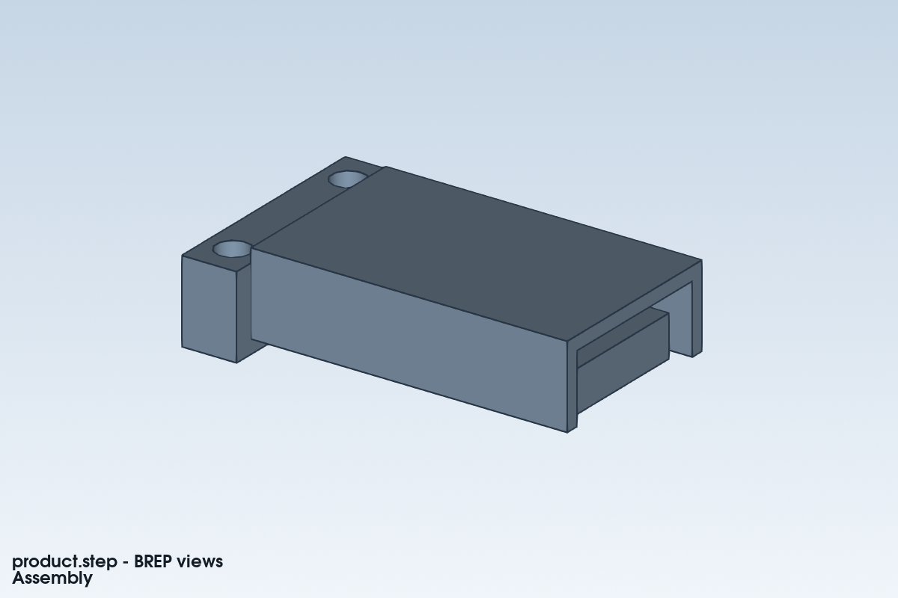

# SimpleCAE

**帮助 CAD／机器人 Agent 选对检查、解释结果，并推动下一次设计修改。**

[English](README.md) · [Skill入口](SKILL.md) ·
[完整案例](examples/showcase/README.md) · [Agent安装](references/agent-installation.md)

说明准备做什么、怎样使用、什么表现会影响体验。SimpleCAE帮助Agent选择有用的
检查、组织本地计算、定位控制问题，把结果转成CAD／机器人工具能继续执行的建议。

底层使用Python、Gmsh和开源命令行求解器CalculiX，不需要商业CAE软件、
云求解账号或工具内部的API密钥。调用Agent仍需自己的模型、宿主和终端权限。

> “这是机器人控制板的导热支座，热源5 W。请在指定冷却条件下把桥温度控制在
> 40°C以内，用SimpleCADAPI改模型，用SimpleCAE检查，并展示修改为什么有效。”



随包案例只分析关键**导热桥**，没有把装配体每个零件都求解。
原2 mm厚桥约 **49.94°C**，只加厚至4 mm后约 **34.97°C**；
5 W热源、理想20°C冷端和40°C上限均不变。实际接触热阻和冷端散热仍待核实。
[复现两版模型与分析](examples/showcase/thermal-bridge/README.md)。

`simplecae --version`显示实际版本。公开发布包携带绑定源码的验证摘要；
修改源码后不能继续沿用旧快照的资格。[验证范围](references/platform-evidence.md)。

## 主要价值

- **先理解用途，再选择分析。** 手动机构可能先查装配，定位机械臂可能先查关节。
  写清影响用户体验的问题、检查对象和选择理由。
- **给出能执行的下一步。** 保留控制判据、零件、位置和原因；有效失败推动改CAD，
  网格或数值失败先修分析，不直接判定结构太弱。
- **把迭代放进同一记录。** 单个task、CLI／JSON和Viewer连接需求、计算、
  外部检查与修订；不会擅自修改CAD或执行批注。
- **证据不足时不给“好消息”。** 预紧阶段、局部热点、未完成检查均保留；
  主体通过不等于安装、机器人精度或产品通过。
- **本地运行，控制资源和占用。** 有限预算、按需检查、实测多核；
  默认无损压缩原生文本，保留完整场和关键证据。

## 能做什么

| 使用问题 | 支持的检查 | 主要边界 |
|---|---|---|
| 太软、应力太大？ | STEP或适用网格实体的线弹性强度／刚度、任务测点、平衡和收敛 | 需明确材料、制造和安装条件 |
| 安装后会移动？ | 多实体、平面分离／摩擦、等效轴向螺栓预紧→锁定→加载 | 不覆盖任意曲面接触、大滑动、真实螺纹、螺杆弯剪或锚固拉拔 |
| 弹性失稳？ | 支持范围内的线性特征值屈曲 | 不等于带缺陷的非线性极限承载 |
| 机器人末端为什么偏？ | URDF静力、选中连杆有限元、截面一阶传递和显式关节柔度 | 适用固定基座树形机构／保持状态；非通用柔性多体 |
| 加速制动电机够不够？ | 指定同时运动状态的力矩与安装载荷 | 非控制器或完整轨迹动力学 |
| 太热？ | 稳态／瞬态热网络及针对性实体导热 | 非CFD或自动热应力耦合；局部热流精度需独立证据 |
| 接近激振频率？ | 模态频率与振型 | 幅值任意，不预测强迫响应幅值 |
| 反复用、长期承载？ | 依据适用材料曲线及明确应力／温度的疲劳、蠕变检查 | 不凭空生成FDM耐久限值或外推寿命 |
| 能否装上、转动、实物好用？ | 记录CAD工具、测量与实测的修订绑定证据 | 记录不等于独立认证 |

[用途与方法选择](references/use-driven-checks.md) · [详细能力与输入](SKILL.md)

## 三个完整案例，三种决策

| 案例 | 用户需求 | 展示的价值 |
|---|---|---|
| [控制板导热支座](examples/showcase/thermal-bridge/README.md) | 四部件、5 W、40°C上限 | 热阻与实体温度共同支持加大截面，包含两版CAD |
| [两关节巡检臂](examples/showcase/inspection-arm/README.md) | 0.2 kg、0.5 mm精度、三种运动状态 | 分开关节和连杆贡献；适用性不足时阻止盲目加厚 |
| [螺栓传感器立柱](examples/showcase/sensor-mast/README.md) | 完整接触、预紧锁定、根部圆角 | 工作阶段通过不能掩盖预紧阶段的局部应力不收敛 |

包含自建SimpleCADAPI可编辑源文件、几何与可移植输入。只运行CAE无需CAD环境。
`quickstart`较简单的数学参考用于验证安装及结果行为，不代替这些结构案例。

## 安装运行环境

当前目录包含 1.6.0 的首次使用流程修复。[本次验证范围](validation/README.md)
单独说明；旧发布凭证已归档，不作为当前源码的验证声明或安装门槛。

若要安装到 Agent 的技能目录，先做下节的“安装到 Agent”，再进入安装目标运行
以下命令，只建立一次环境。直接让 Agent 使用当前源码目录则无需再复制一份。

源码放在可写目录，准备 **64位Python 3.11以上**，推荐共同基线Python 3.11。
首次下载依赖需要联网；以下命令在SimpleCAE目录执行。

**Windows PowerShell**

```powershell
powershell -NoProfile -ExecutionPolicy Bypass -File scripts/bootstrap.ps1
.\.venv\Scripts\python.exe scripts/simplecae_cli.py --version
# 可选：只运行一个真实求解示例
.\.venv\Scripts\python.exe scripts/simplecae_cli.py quickstart --out outputs/first-001
```

无需激活环境。脚本优先复用符合依赖范围的本地环境和已配置求解器；需要新装时
只安装运行依赖。`-Locked` 留给需要复现完整测试依赖的维护者。新下载的求解器
仍在解压前校验完整性。自选解释器／求解器加 `-Python PATH`、`-Ccx PATH`。
Python 必须包含 `venv` 和 `ensurepip`；Agent 自带的精简版可能没有，可直接指定
机器上已有的完整版 Python。已有正常环境不需要另找系统 Python。

**Ubuntu / bash**

使用正常系统包管理权限安装依赖：

```bash
sudo apt-get update
sudo apt-get install python3-venv calculix-ccx libglu1-mesa libxft2 libxcursor1 libxinerama1 libgomp1
bash scripts/bootstrap.sh
.venv-linux/bin/python scripts/simplecae_cli.py --version
# 可选：只运行一个真实求解示例
.venv-linux/bin/python scripts/simplecae_cli.py quickstart --out outputs/first-001
```

所选Python必须>=3.11，必要时加 `--python /path/to/python3.11`；
自备求解器加 `--ccx /path/to/ccx`。bootstrap本身不执行sudo或修改系统包。
Linux使用独立 `.venv-linux`，保留共享目录中的Windows求解器配置。
Ubuntu依赖按声明版本范围解析，复现时记录 `doctor` 输出。

已有正常环境可直接开始用户任务。`quickstart --example all`、完整 pytest、许可证
审计和发布验证都不是首次使用的必经步骤；全部示例仅供需要了解不同结果时选用。
已有 quickstart 结果可以直接查看，需要重新求解时再使用新目录，避免覆盖旧证据。
单独打开 Viewer 不会启动求解。

已有环境也可用 `python -m simplecae`。wheel含运行资源及示例；
安装到Agent的skill使用**源码文件夹**。[依赖说明](references/dependencies.md)。

## 安装到 Agent

可直接让Agent“读取这个目录的SKILL.md并使用SimpleCAE”。需要自动发现时，
直接安装源码文件夹即可；查看目标是可选步骤：

```text
python scripts/install_local.py --agent codex --show-target
python scripts/install_local.py --agent codex
```

普通安装不要求发布凭证，不反复计算源码、备份或安装副本的 SHA-256；凭证缺失或
过期都不会阻塞安装，也不需要重新生成凭证或对比 GitHub 文件。
`--verify-release` 只供维护者主动审计发布源码；`--development` 兼容普通安装，
同样不要求凭证。下载求解器的完整性检查和分析结果有效性检查仍保留。
DeepSeek Harness 项目级安装可用：

```powershell
python scripts/install_local.py --skills-root 'C:\你的工作区\.dsh\skills'
```

| 宿主 | `--agent` | 默认发现目录 |
|---|---|---|
| Codex | `codex` | `$CODEX_HOME/skills`，否则`~/.codex/skills` |
| Claude Code | `claude` | `$CLAUDE_CONFIG_DIR/skills`，否则`~/.claude/skills` |
| DeepSeek Harness | `deepseek` | `~/.agents/skills` |
| OMP / oh-my-pi | `omp` | `~/.omp/agent/skills` |
| Pi | `pi` | `~/.agents/skills` |

项目或自定义profile加 `--skills-root PATH`。安装器备份受管理源码，保留已有环境、
工具、结果和无关根目录文件。新安装目录运行bootstrap，再刷新宿主技能发现；
复制源码本身不等于安装Python环境。[详细说明及官方文档](references/agent-installation.md)。
目录兼容验证不代表已测试每个Agent／模型组合。

## Agent 怎么用

1. 写清用途、成功标准、未知条件和允许修改。
2. 选能改变设计判断的检查，定义完整受力／传热路径，写一个task文件。
3. 运行选中检查，解释有效性、范围、位置及控制判据。
4. 有依据才改CAD；重绑接口，保持工况与判据，建立新修订。

```text
simplecae task start examples/showcase/thermal-bridge/r1/task.json --out outputs/bridge-r1 --run temperature --brief
simplecae task start examples/showcase/thermal-bridge/r2/task.json --out outputs/bridge-r2 --viewer-session outputs/bridge-r1/viewer --run temperature --brief
simplecae task status outputs/bridge-r2 --brief
simplecae view --session outputs/bridge-r1/viewer --serve --open
```

不加 `--run` 只准备不计算。`task run --check NAME`选择另一项；
`task record`记录外部证据。未变计算重试需具体 `--retry-reason`，通过项不必重复。
[任务入口](references/agent-tasks.md) · [Python／JSON接口](references/agent-api.md)。

和 [text-to-cad](https://github.com/earthtojake/text-to-cad) 配合时，cadgen负责
参数化模型、导出和适用制造检查；和
[SimpleCADAPI](https://github.com/PhySpace/SimpleCADAPI) 配合时，notebook负责
特征、装配约束与STEP。SimpleCAE消费导出模型及显式物理输入，把反馈交给调用Agent。
两者均为可选组合，不是强制或后台自动调用的依赖。

## 结果、Viewer 与磁盘

| 状态 | 含义与行动 |
|---|---|
| `pass_under_stated_model` | 已评估判据在声明模型内通过，继续其他要求 |
| `fail_under_stated_model` | 有效证据表明不满足，提出针对性改型 |
| `indeterminate` | 证据／覆盖／收敛不足，不能有利排名或授予承重 |
| `invalid` | 输入／环境／网格／求解校验失败，先修分析 |

`result.json`、`signal.json`、`report.html`及任务／设计摘要保留依据。
一项未决不抹掉另一项已证实的失败；数值状态不会自动授予产品通过。

Viewer显示真实场、修订、阶段与批注，只监听 `127.0.0.1`；
无自动上传和外部网页资源。批注不会执行CAD命令。[显示边界](references/viewer.md)。

默认 `compact` 在读写结束后无损压缩DAT／FRD／MSH，保留全部网格档位、完整场、
输入、日志和失败；不自动删老项目或另建一份缓存。[保存规则](references/storage.md)。

复杂任务先看 `doctor` 和执行记录，选择有依据的预算；同类静力／接触任务可对
代表性输入做一次多核标定。自动模式选适用的实测配置，否则单线程。
不保证稀疏矩阵一定能装入内存，不为赶时间降低准确性判据。
[多核与预算](references/execution-resources.md)。

## 反馈、验证、许可

用[反馈模板](assets/feedback-template.md)附最小可分享输入、版本／平台、预期判断和日志；
分享前检查模型和路径隐私，不会自动上传。

[贡献说明](CONTRIBUTING.md) · [数值验证](references/release-requirements.md) ·
[当前证据](references/platform-evidence.md)

源码、文档和自建示例 **GPL-3.0-or-later**，见 [LICENSE](LICENSE)、
[NOTICE](NOTICE.md)及[依赖清单](licenses/dependency-inventory.json)。
源码包排除环境、求解器二进制、用户结果及私人审计历史；
另行分发依赖须遵守其自身许可。
