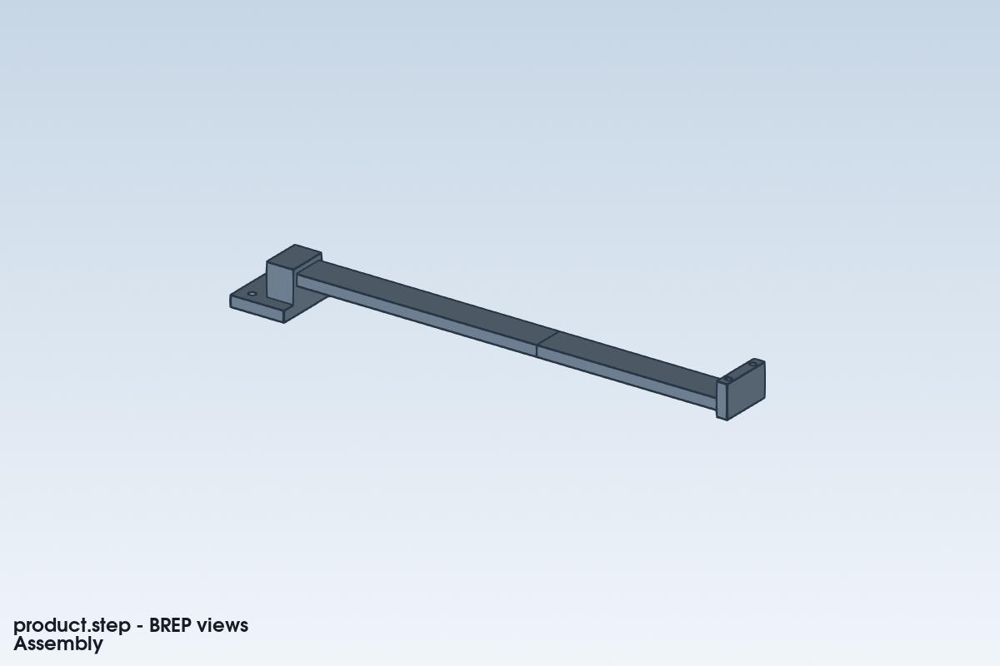

# Inspection arm: improve the right source of flexibility

A four-part CAD assembly and a two-joint URDF carry a 0.2 kg payload. The user
wants <=0.5 mm tip deflection and <=2 N·m drive demand. Link lengths are
180/140 mm; the task includes two held poses and three motion states.



This example demonstrates a useful **stop-and-diagnose** outcome. Equivalent
output-side joint stiffness is explicitly assumed (200/80 N·m/rad); it cannot
be inferred from URDF effort or damping. SimpleCAE combines this contribution
with selected link FEM and checks the applicability of the first-order transfer.
An individual link pass is not a whole-arm precision pass.

```text
simplecae task start examples/showcase/inspection-arm/task.json --out outputs/arm-01 --run motion --brief
simplecae task run outputs/arm-01 --check compliance --brief
simplecae view --session outputs/arm-01/viewer --serve --open
```

The current assumed arm does **not** establish the requested whole-arm precision:
the compliance check retains unresolved transfer applicability. Read the
per-pose joint/link contributions and section-warping/small-response gates.
Do not use its raw displacement to calculate an automatic thickness multiplier.
The Agent should review the held joint model and load-transfer ports first, then
choose an allowed structural or joint change and run a fresh revision.

The motion calculation covers only named hold, acceleration and braking states.
It does not simulate a controller or qualify a full trajectory, torque-speed
curve, drive heating or link dynamic stress. Geometry and real joint/drive data
remain separate task records.

The editable SimpleCADAPI notebooks, STEP parts, STL visuals, URDF, component
cases and task inputs are included. Rebuilding CAD requires SimpleCADAPI 2.2.4;
running these existing CAE inputs does not.

## 中文

这是一台四部件、两转动关节的小巡检臂：挂0.2 kg，要求末端偏移不超过
0.5 mm、驱动需求不超过2 N·m。Agent先算保持／加速／制动需求，再检查
关节柔度与两根连杆弯曲共同造成的偏移。

本例的意义是**阻止改错地方**：关节输出刚度是假设值，整链传递的适用性
尚未全部通过，不能因为连杆单独通过就宣布整机精度通过，也不能据原始
位移直接给出加厚倍数。先检查关节保持状态、截面翘曲与载荷传递，再决定
修改连杆还是关节配置。原有阈值、失败和未知项均保留。
