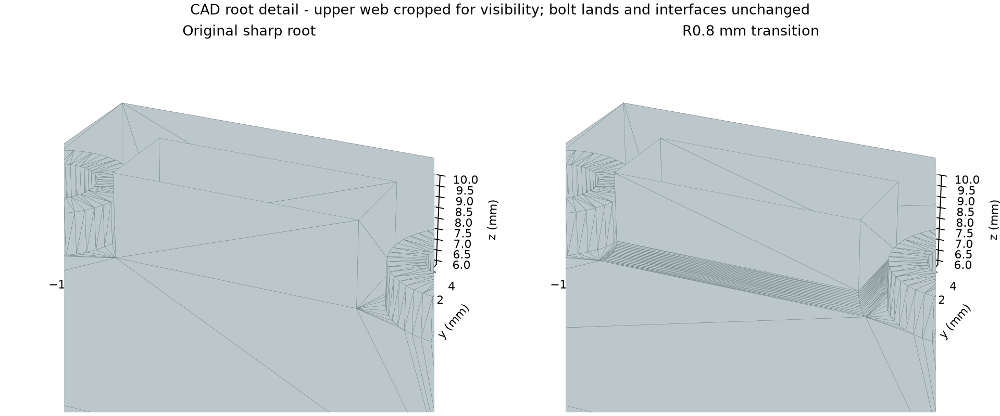

# Bolted sensor mast: keep the inconvenient hotspot

The model includes a mast, supported base, frictional foot and two equivalent
axial bolts. Each bolt is tightened to 300 N, its adjustment is locked, and the
mast receives the original [0, 5, -50] N service force plus gravity.



The four mast-root edges have R0.8 mm transitions, preserving 0.2 mm clearance
to the neighboring boss footprint. The hole, bearing lands, force face and
mounting interfaces were retained. This is a compact example of
**CAD modification → full mounting reanalysis → located unresolved feedback**.

```text
simplecae task start examples/showcase/sensor-mast/task.json --out outputs/mast-01 --run mounting --depth detailed --budget-seconds 600 --brief
simplecae view --session outputs/mast-01/viewer --serve --open
```

The 600-second allowance is a configurable starting point, not a guarantee for
every computer. Inspect the resource plan and native logs. For a repeated contact
family, a measured multithreaded solver configuration can help; see
[resource planning](../../../references/execution-resources.md).

The original qualified computation completed 4,708 / 7,434 / 14,935 elements.
At the service endpoint, the finest result was 12.768 MPa and 0.101096 mm,
and the checked root regions converged. **The full result remains
`indeterminate`:** preload/locked stress changed by about 17.79% against the
original 10% gate. Neighboring boss/foot corners and short root transitions
remain sensitive. Different supported runtimes may produce different meshes;
the executable criteria, not these recorded numbers, decide the new result.

Generic `stress_regions` inspect separate root boxes at all three stage
endpoints. They retain every integration point of intersecting elements;
an assembly-wide maximum cannot hide a secondary local hotspot.
An unconverged peak is neither a proven weak part nor proof of a mathematical
singularity. The next CAD hypothesis should address the actual boss/foot and
end transitions, without lowering preload or cropping stress.

Editable SimpleCADAPI notebooks and STEP/STL geometry are provided. STL is
geometry exchange, **not** evidence for an FDM part: this case uses equivalent
aluminum. Real screw bending/shear, threads, fatigue, plastic collapse and
intermediate load-increment peaks are outside this example.

## 中文

传感器立柱不是“底面全固定”的简化演示：计算保留底座、脚部摩擦接触、
两根各300 N预紧螺栓，以及锁定后加载。根部四边加R0.8圆角，接口与载荷不变。

工作阶段约12.77 MPa、0.1011 mm且所查根部区域收敛；预紧／锁定阶段仍有
约17.79%的应力变化，超过10%原判据。因此完整结论是“证据不足”。
这正是Agent应保留的反馈：定位邻近承压台／足板及短边过渡，继续有依据的
CAD修改，而不是用工作阶段通过掩盖安装阶段问题。
